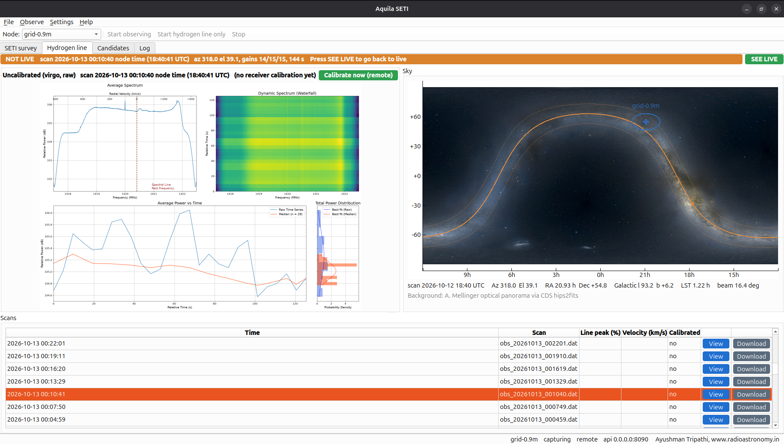
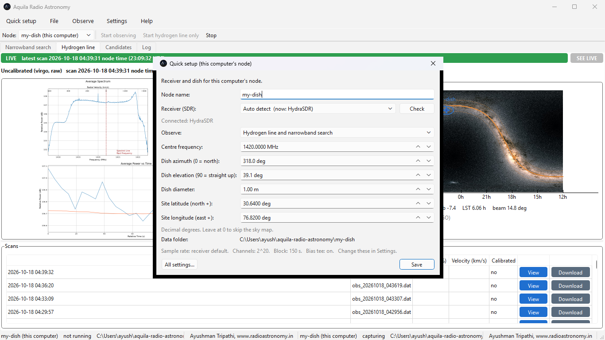
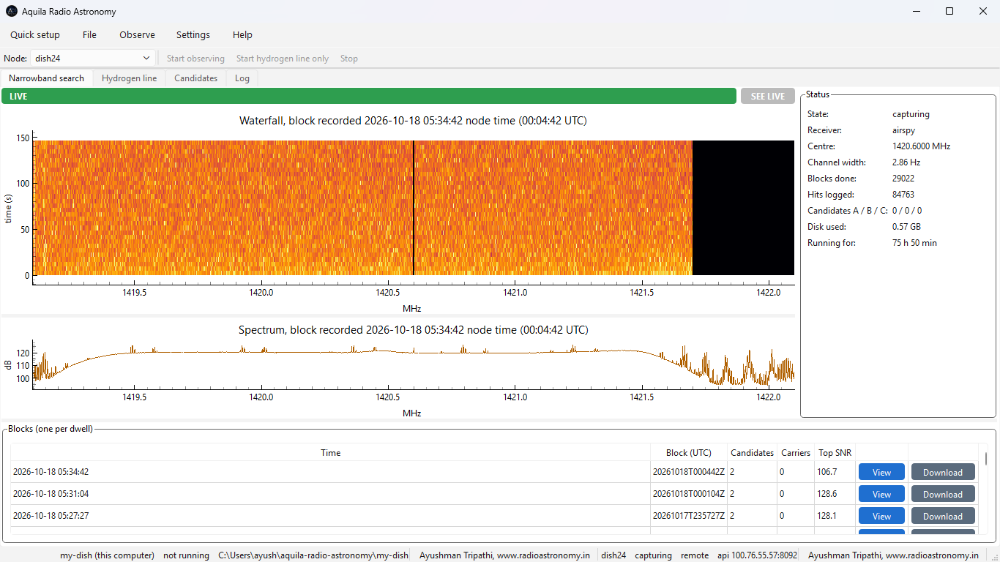

# Aquila Radio Astronomy

Desktop app and observing node for a dish and an SDR. It does two things with one observation: hydrogen line spectra of whatever the dish is looking at, and a narrowband drift search across the band. Point the dish, plug in the receiver, press Start.

Works with Airspy, HydraSDR, RTL-SDR and HackRF. Runs on Windows, Linux and macOS, and as a headless node on a Raspberry Pi. Several nodes can be watched from one desktop over the network.

Ayushman Tripathi, [radioastronomy.in](https://radioastronomy.in/). MIT licence.



## Install

Packages for Windows, Ubuntu and macOS are on the [Releases](../../releases) page. Each one contains everything, including the receiver tools.

| | |
|---|---|
| Windows | `.msix` installer, or the `.zip` to run from any folder |
| Ubuntu, Debian | `.deb`, double-click it or `sudo apt install ./aquila-radio-astronomy_*.deb`. Or the snap |
| macOS | `.dmg`. It is not signed yet: right-click the app and choose Open the first time |

From source, with Python 3.10 or newer:

```
pip install ".[gui,hline]"
aquila gui
```

A source install needs the vendor tool for your receiver on PATH: `airspy_rx`, `hydrasdr_rx`, `rtl_sdr` or `hackrf_transfer`. On Windows the receiver runs on the WinUSB driver: Airspy, HydraSDR and HackRF get it from Windows by themselves when first plugged in, an RTL-SDR needs it installed once with [Zadig](https://zadig.akeo.ie/); the app tells you when that is the problem.

## First run

The app opens on a Quick setup page with everything filled in: the receiver it found, the centre frequency, where the dish points. Choose hydrogen line only or the narrowband search as well, press Save, then Start observing. The choice can be changed any time in Settings; with the search off its tabs are hidden.



Settings has the rest, with working defaults. Advanced values live in the config file under `advanced` and rarely need touching.

## What you get

**Narrowband search.** Every 150 s block of the receiver goes through a 2^20 point FFT into a waterfall a few Hz per channel. Every channel is divided by its own median over the block, which flattens the passband and anything fixed in frequency; a drifting signal survives. Every integer channel shift across the block is then tried, a de-Doppler search, and channels above threshold are logged as hits with their drift, width and how many rows of the block they occupy. Strong steady carriers go to a separate list. Hits are linked across blocks offline: a track that drifts relative to the receiver's own reference and lasts a beam transit is tier A; a frequency seen at widely separated times of the same day cannot be the sky and is dropped.



**Hydrogen line.** The same block is binned to 1024 channels and written as a [virgo](https://github.com/0xCoto/VIRGO) scan, so the line plots update every block while the search runs. Take one receiver reference, a 50 ohm terminator on the LNA or a patch of cold sky, and every scan after that is calibrated. A hydrogen-line-only mode exists for machines too weak for the big FFT.

**Nothing piles up.** Raw samples never touch the disk, memory is fixed, and disk use is capped, so a node runs for months unattended. What is kept: hit tables, a thumbnail per block, small snippets around the strongest hits, the hydrogen line scans.

**Remote nodes.** A node serves its own files over HTTP. Add its address in the app and you see its live waterfall, plots, tables and log, with a daily data cap for metered links and a token that lets the app queue a calibration on it.

## Command line

```
aquila run        # observe until stopped: narrowband search plus hydrogen line
aquila hline      # hydrogen line only
aquila cal        # one receiver reference scan
aquila status
aquila curate     # tier the hits into candidates.csv
aquila serve      # the node's HTTP side on its own
```

`deploy/aquila-node@.service` runs a node as a systemd service on a Pi.

## Files

Everything lands in `~/aquila-radio-astronomy/<node name>/`: `hits.csv`, `rfi.csv`, `candidates.csv`, `blocks.csv`, `status.json`, `latest.png`, `waterfalls/`, `snippets/`, `hline/`.

## Hardware this runs on

A 2.4 m dish with an Airspy at a remote site on a Raspberry Pi over a cellular link, a 0.9 m dish with a HydraSDR on a laptop, and a HackRF on a Ku band LNB. The defaults in the config are the ones those dishes use.

## Development

```
pip install ".[gui,hline]" pytest ruff
ruff check aquila tests
pytest
aquila run --sdr synthetic --blocks 2     # no hardware needed
```

```
aquila/config.py     one JSON config, defaults
aquila/sdr.py        receivers; adding one is a small class
aquila/dsp.py        channelizer, normalisation, drift search
aquila/survey.py     the observing loop
aquila/hline.py      hydrogen line scans and calibration
aquila/curate.py     candidate tiers
aquila/store.py      files, status, disk caps
aquila/api.py        the node's HTTP side
aquila/gui.py        the desktop app (PySide6, pyqtgraph)
```

Packaging and the release process are in [docs/PACKAGING.md](docs/PACKAGING.md).

## Credits

Hydrogen line plots are drawn by [virgo](https://github.com/0xCoto/VIRGO) (GPL-3). The sky map background is the ESA Gaia EDR3 all-sky map (ESA/Gaia/DPAC, CC BY-SA 3.0 IGO), reprojected to equatorial coordinates.
